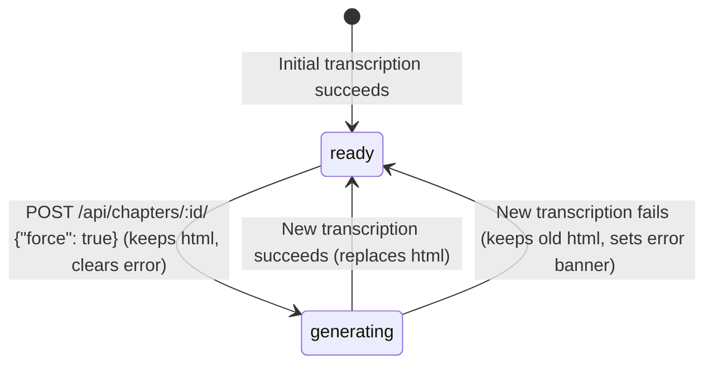

# High-Signal PR Report Example

**Title:** `feat(chapters): preserve previous chapter HTML while rebuilding`

````markdown
## Goal

Allow readers to keep reading the existing chapter content while a chapter rebuild (`POST /api/chapters/:id/` with `{"force": true}`) is queued or generating, and surface a non-destructive warning banner if the rebuild fails instead of wiping out the previously ready HTML.

## Unknown Unknowns & Plan Drifts

- **Cascade cleanup on outline rebuild**: While testing full document outline rebuilds (`{"outline": true}`), deleting old chapter rows left orphaned chapter job records in `jobs`. Added `ON DELETE CASCADE` on `jobs.chapter_id` in migration `v0003_keep_previous_chapter_html.sql` so outline rebuilds remain atomic.
- **Anchor map consistency**: Kept the previous chapter's anchor entries active until the new chapter compilation succeeds, avoiding broken cross-chapter links during regeneration.

## Visual Explanation & Live Evidence



- **PostgreSQL dual-worker crash recovery** (`scripts/check_postgresql.py`): Verified that killing the active worker mid-rebuild leaves the existing `html` intact and allows the second worker to recover the lease and complete replacement.
- **End-to-end Playwright verification** (`npm test --prefix web` on Chromium & WebKit):
  - Triggered chapter rebuild on a `ready` chapter → verified previous paragraphs remain visible while the header spinner is active.
  - Injected a failing `REPAGE_FAUX_SESSION` script on rebuild → verified the warning banner renders above the preserved chapter text and the retry button succeeds on a subsequent attempt.
````
